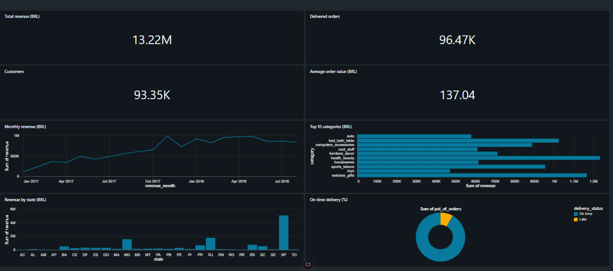
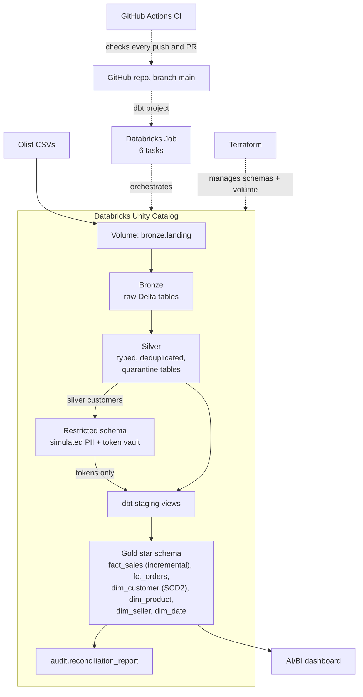

# Databricks Lakehouse: Olist Sales (Azure-ready Terraform)

[](https://github.com/sushii-code/azure-lakehouse-sales/actions/workflows/ci.yml)

An end-to-end medallion lakehouse running on Databricks Free Edition (Unity Catalog, Delta, PySpark, dbt), built on the Olist Brazilian e-commerce dataset (~100k orders), with data quality, GDPR handling, orchestration, CI and Terraform; the Azure ADLS Gen2 Terraform is validated in CI but not deployed.

**Author:** Gnana Sushmitha Tammisetti | [GitHub](https://github.com/sushii-code) | [LinkedIn](https://www.linkedin.com/in/gnanasushmitha)



*Olist Sales Overview in Databricks AI/BI: 13.22M BRL revenue, 96.47K delivered orders, 93.35K customers, 137.04 BRL average order value.*

## Architecture



## Tech stack

| Area | Tools |
| --- | --- |
| Platform | Databricks Free Edition, Unity Catalog, Delta Lake, serverless compute |
| Ingestion and cleaning | Python, PySpark |
| Modelling and tests | dbt (dbt-databricks, dbt_utils), SQL |
| Orchestration | Databricks Jobs |
| Dashboard | Databricks AI/BI |
| CI | GitHub Actions, ruff, sqlfluff, gitleaks |
| Infrastructure as Code | Terraform (Databricks provider; Azure provider validated only) |
| Synthetic data and profiling | Faker, DuckDB |

## Key features

| Feature | What it does |
| --- | --- |
| **Data quality** | Bad rows go to quarantine tables with a reason (14 orders, 3 payments, 42 geolocation points). 551 duplicate reviews removed. |
| **Reconciliation** | Every bronze row is accounted for through to gold. The build fails if layers drift. |
| **Testing** | 44 dbt tests across 17 models. Latest full build: `PASS=60 WARN=1 ERROR=0`. The warning is the 15 known orphan items, documented below. |
| **SCD Type 2** | `dim_customer` keeps address history (102,092 versions, 96,082 current). An as-of join links each sale to the address valid at purchase time. |
| **GDPR** | Synthetic PII sits in a restricted schema. Silver holds tokens only (233,661 in the vault). Reruns add 0 tokens. Designed for right to erasure: delete a person's vault entries and their tokens mean nothing. |
| **Incremental loading** | `fact_sales` merges on `sales_key` with a 3-day lookback. Proved by deleting 6,566 rows and restoring exactly 112,635. |
| **Orchestration** | 6-task Databricks Job, 4m 41s end to end, with parallel silver tasks. dbt runs from GitHub `main` with no stored token. The 06:00 schedule exists but is paused to save compute. No table-update trigger, because the job writes those tables and would trigger itself forever. |
| **CI** | ruff, sqlfluff, `dbt parse` with a dummy profile, gitleaks and `terraform fmt`/`validate`. No real credentials. |
| **Infrastructure as Code** | Terraform imported 6 schemas and the landing volume. Plan shows `No changes`. All are protected with `prevent_destroy`. Azure ADLS Gen2 code is validated only. |

### Revenue trail

| Step | Revenue (BRL) | Note |
| --- | --- | --- |
| Silver order items | 13,591,643.70 | All items |
| Gold `fact_sales` | 13,589,748.34 | Minus 1,895.36 for the 15 excluded items |
| Delivered orders | 13,220,248.93 | Completed sales only |
| *If payments were joined to items* | *14,209,115.34* | *Fan-out would overstate revenue by about 4.5%, so this join is never used* |

## Screenshots

- [dbt lineage graph](docs/images/dbt_lineage.png)
- [Reconciliation report](docs/images/reconciliation_report.png)
- [Databricks job run](docs/images/databricks_job_run.png)
- [Databricks job timeline](docs/images/databricks_job_timeline.png)

## Repository structure

```
.github/workflows/ci.yml   CI pipeline
ci/profiles.yml            Fake dbt profile, used only by dbt parse
dashboards/                SQL behind the dashboard
dbt/                       Staging, gold and audit models, tests, macros
docs/                      Data model, learnings, screenshots
jobs/                      Databricks job definition (written by hand to document the job)
notebooks/                 build_silver notebook and early DuckDB profiling scripts
src/bronze/                Setup and bronze ingestion
src/silver/                Remaining silver tables
src/simulator/             Synthetic PII, house moves and token vault
terraform/databricks/      Unity Catalog schemas and volume (applied)
terraform/azure/           ADLS Gen2 storage (validated only)
```

## How to run it

You need a Databricks workspace with a SQL warehouse and the [Olist dataset](https://www.kaggle.com/datasets/olistbr/brazilian-ecommerce).

1. Clone the repo, create a virtual environment and run `pip install -r requirements.txt`.
2. Import `src/bronze/00_setup.py` into Databricks and run it. Upload the 9 CSVs to `/Volumes/workspace/bronze/landing/olist/`.
3. Run the other notebooks in this order, or create a job that matches `jobs/olist_lakehouse_pipeline.yml`:
   `src/bronze/01_bronze_ingest.py`, `notebooks/build_silver.ipynb`, `src/silver/silver_more.py`, `src/simulator/customer_pii.py`.
4. Set `DATABRICKS_HOST` and `DATABRICKS_TOKEN` as environment variables in your terminal. The token is only ever an environment variable and is never committed.
5. Create `~/.dbt/profiles.yml` outside the repo, with a profile named `azure_lakehouse_sales` that reads the token through `env_var('DATABRICKS_TOKEN')`.
6. Run `cd dbt`, then `dbt deps`, then `dbt build`.
7. Optional: run `terraform init`, `plan` and `apply` from `terraform/databricks`. Run this after step 6, because the config imports schemas that must already exist.
8. Run the queries in `dashboards/sales_dashboard.sql` to rebuild the dashboard.

## Known gaps and design decisions

**Known gaps**

| Gap | Why |
| --- | --- |
| 15 order items are not in `fact_sales` | Their 14 orders were quarantined, so the order details can't be trusted. A test proves these are exactly the excluded items. |
| 14 customers are not in `dim_customer` | Their only order was quarantined, so they have no starting address. A test proves this. They have no sales in `fact_sales`. |
| Address moves are simulated | Olist has no address history, so 6,010 moves were generated with Faker. They have no postcode, and some fall after the data ends. |
| Personal data is synthetic | Olist is anonymised, so names, emails and phones were generated with Faker. |
| Access controls are not enforced | Free Edition has a single user, so the `GRANT` and `REVOKE` design is documented but not applied. |
| Azure is validate-only | I have no Azure subscription yet. CI validates the code, but it has never been deployed. |
| Older rows need a full refresh | The 3-day lookback only reprocesses the newest rows, so changes to older sales need `--full-refresh`. |

**Design decisions**

- **Fact grain is one row per order item,** because price, freight and seller are recorded per item.
- **Payments are aggregated per order in `fct_orders`,** never joined to `fact_sales`, to prevent fan-out.
- **Bad facts are quarantined, suspect dimensions are flagged.** Removing a product would orphan its order items, so 6 products get `is_weight_suspect` instead.
- **SCD2 is event-based, not dbt snapshots,** so history comes from when a change happened and can be rebuilt on every run.
- **Tokenisation, not hashing,** so deleting a vault entry erases the link to the person.

More detail: [data model](docs/data_model.md) and [day-by-day learnings](docs/learnings.md).

## What I learned

- **Prove the numbers.** A reconciliation report and tests that fail the build are stronger than saying the data is correct.
- **Joins can silently change totals.** Joining payments to items inflated revenue by 617,471.64 before I aggregated first.
- **Flag or quarantine depends on the table.** Removing a dimension row breaks every fact that points to it.
- **Check your checks.** My translation check counted categories spelled the same in both languages as untranslated. I fixed it with a `has_translation` flag.
- **Read the error, then check where you are.** I ran dbt from the repo root, typed SQL into PowerShell, and counted rows before a build had finished. Each looked like a bug and wasn't.
- **Job settings are exact.** A GitHub URL in the project directory box and hidden spaces before `dbt` both broke the job until I fixed them.
