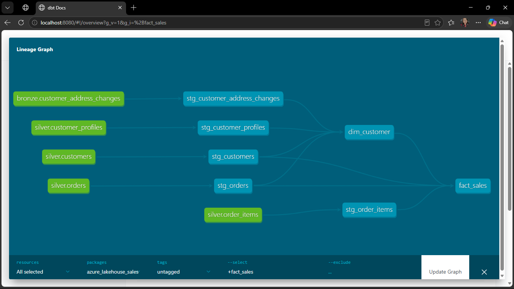
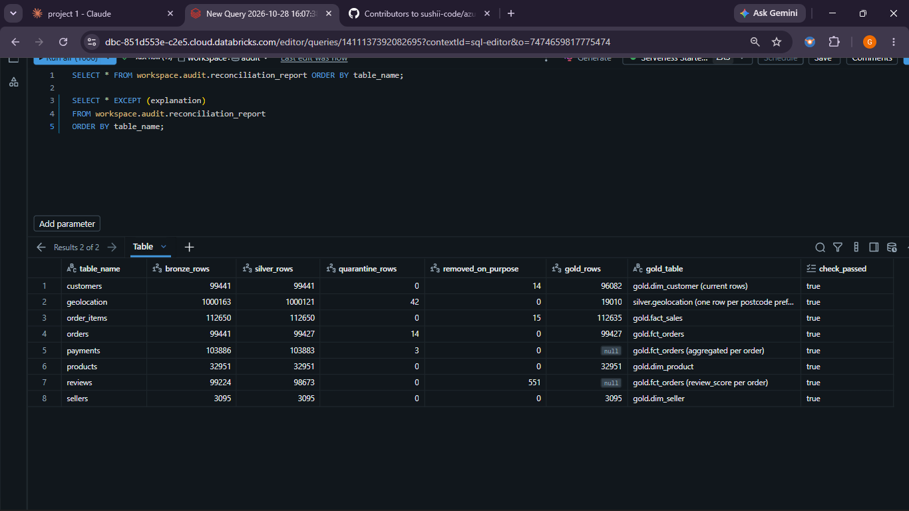
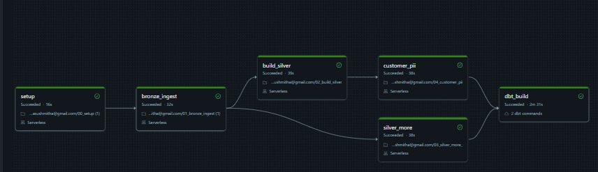
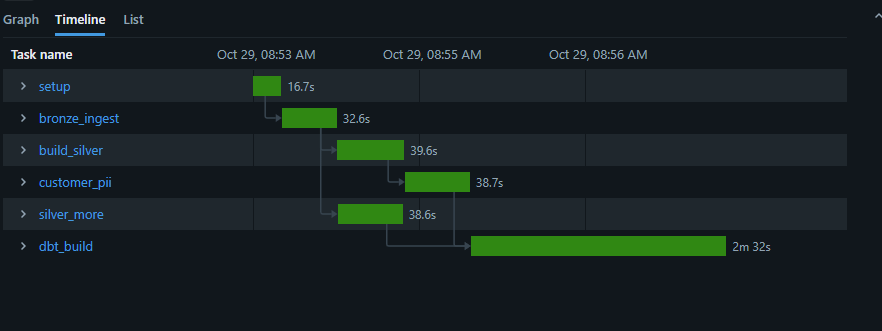

# Data model

This document describes the source data, the target star schema, and the design decisions behind it.

## Source tables (Olist)

Row counts profiled on 17 October with DuckDB (`notebooks/row_counts.py`).

| Table | Key(s) | Rows | One row means (grain) | Notes |
| --- | --- | --- | --- | --- |
| orders | order_id | 99,441 | one order | Status plus purchase, approval and delivery timestamps |
| order_items | order_id + order_item_id | 112,650 | one item within an order | More rows than orders: one order can contain several items |
| customers | customer_id | 99,441 | one customer ID (a new one per order) | customer_id is new on every order; customer_unique_id is the real person |
| payments | order_id + payment_sequential | 103,886 | one payment method used for an order | More rows than orders: one order can be paid in several ways (e.g. card plus voucher) |
| reviews | review_id | 99,224 | one review | Comments can contain line breaks, so row counts can differ slightly between tools |
| products | product_id | 32,951 | one product | Category names are in Portuguese |
| sellers | seller_id | 3,095 | one seller | Seller location (zip prefix, city, state) |
| geolocation | (none – zip prefix, many rows) | 1,000,163 | one postcode-prefix map point | Largest table; several points per zip prefix, so it must be deduplicated before joining |
| category translation | product_category_name | 71 | one category name translation | Portuguese to English category names |

### Profiling findings

- **Customer identity:** customer_id is unique per order (99,441 distinct values), but there are only 96,096 distinct customer_unique_id values. So 3,345 orders came from repeat customers. Customer dimensions and counts must use customer_unique_id, or customers would be overcounted by 3,345.
- **Fan-out:** order_items and payments both have more rows than orders. Joining orders to either table multiplies order rows, so order-level totals must be calculated carefully to avoid double counting.
- **Size:** geolocation (over 1 million rows) is far larger than any other table, and has no unique key. It needs deduplication and care for performance.

## Fact table grain

**One row per order item (order_id + order_item_id).**

Why: price, freight value and seller are recorded per item, not per order. Choosing the order item as the grain means every sales figure can be added up correctly to any level (order, product, seller, customer, day) without double counting.

## Dimensions

| Dimension | Natural key | SCD type | Why |
| --- | --- | --- | --- |
| dim_customer | customer_unique_id | Type 2 | Customer location can change over time; history is kept so each sale is linked to where the customer lived at the time |
| dim_seller | seller_id | Type 2 | Seller location can change; history keeps regional sales reports accurate for past periods |
| dim_product | product_id | Type 1 | Product changes are treated as corrections (e.g. fixing a category), so the old value is overwritten |
| dim_date | date | Static | A fixed calendar table, generated once, that never changes |

## SCD2 approach

*To complete when building the customer snapshot (Project 1, SCD Type 2 step).*

Will cover: how change events are ordered by effective timestamp; how multiple same-day changes, late-arriving changes, deletes and reprocessing are handled.

## Personal data

See [Personal data protection (UK GDPR)](#personal-data-protection-uk-gdpr) below.

### Data-quality findings 

| Check | Rows found | Rule for silver |
| --- | --- | --- |
| Order status breakdown | 96,478 delivered; 625 canceled; 609 unavailable; 1,729 in progress | Only delivered orders count as completed sales in gold. Canceled and unavailable orders are excluded from revenue. |
| Delivered but no customer delivery date | 8 | Flag with `dq_issue = 'delivered_no_date'` and send to quarantine for review |
| Canceled but has a delivery date | 6 | Flag with `dq_issue = 'canceled_with_delivery'` and send to quarantine for review |
| Delivered before purchase | 0 | Keep as an automated test so future loads fail loudly if this ever happens |
| Item prices | Max 6,735.00; no obvious outliers | Add a test that price is greater than 0 |

### Keys and joins 


| Check | Result | What it means |
| --- | --- | --- |
| order_id uniqueness | 99,441 rows, 99,441 distinct, 0 empty | order_id is a valid primary key for orders |
| Repeat customers | 2,997 people ordered more than once | About 3% of customers returned; customer counts must use customer_unique_id |
| Orphan order items | 0 | Items whose order_id has no matching order would be silently dropped by an INNER JOIN |
| Fan-out: items joined to payments | True revenue 13,591,643.70; after join 14,209,115.34; inflated by 617,471.64 (about 4.5%) | Orders with several payment rows duplicate their items. Rule for gold: never sum item prices after joining payments; aggregate payments to one row per order first, then join |

## Bronze layer 

- Location: Unity Catalog `workspace.bronze`; raw files in volume `workspace.bronze.landing/olist/`.
- 9 Delta tables, all columns kept as strings (exactly as received; typing happens in silver).
- Audit columns on every row: `_ingested_at` (load time) and `_source_file` (lineage).
- Loads are idempotent (`overwrite`), so reruns are safe.
- Reconciliation: all 9 bronze row counts match the source files exactly (e.g. orders 99,441; geolocation 1,000,163).

## Silver layer

| Table | Changes from bronze | Quarantine / removed |
| --- | --- | --- |
| silver.orders | Status trimmed and lowercased; 5 date columns typed as timestamps (0 failed conversions) | 14 rows quarantined: delivered_no_date, canceled_with_delivery |
| silver.order_items | Prices and freight as DECIMAL(10,2); item number as INT; shipping date typed | 0 rows quarantined |
| silver.customers | City lowercased, state uppercased, postcode padded to 5 characters (kept as text) | None |
| silver.reviews | One review per order (latest by answer time) using ROW_NUMBER, to prevent fan-out | 551 duplicate reviews removed (99,224 to 98,673) |

Reconciliation: bronze = silver + quarantine for orders (99,441 = 99,427 + 14), order_items (112,650) and customers (99,441). All OK.

Note: empty delivery dates are not errors; 2,965 orders were never delivered (canceled, unavailable or in transit).

## Silver layer (part 2)

| Table | Changes from bronze | Quarantine / notes |
| --- | --- | --- |
| silver.payments | Sequential and instalments as INT; payment_value as DECIMAL(10,2); payment type cleaned | Rows with missing, negative or not_defined payments quarantined; bronze 103,886 = silver + quarantine |
| silver.products | Source typos fixed (lenght to length); measurements as INT; English category names joined from the translation table | 610 products have no category; 2 categories have no translation; 6 products flagged is_weight_suspect (flag, not quarantine, so no order items are orphaned) |
| silver.sellers | City lowercased, state uppercased, postcode padded to 5 characters | None |
| silver.geolocation | Coordinates typed; points outside Brazil quarantined; aggregated to one row per postcode prefix (average point, most common city and state) | 42 points quarantined; 1,000,121 valid points aggregated to 19,010 postcode prefixes, preventing fan-out |

## Personal data protection (UK GDPR)

- Olist is anonymised, so names, emails and phones were simulated with Faker (seeded, so the data is repeatable) for all 96,096 real customers.
- Raw personal data lives only in `workspace.restricted.customer_profiles_raw`.
- `workspace.restricted.token_vault` maps each real value to a random UUID token: 233,661 tokens (names repeat across customers; emails are unique).
- New tokens are created with a left anti join, so reruns add zero tokens (idempotent).
- `workspace.silver.customer_profiles` contains tokens only. Checks: no personal columns, 0 missing tokens, 96,096 rows = real customers.
- Access: analysts read silver and gold only; the restricted schema is limited to the data protection team.
- Right to erasure: deleting a person's vault entries makes their tokens meaningless everywhere, without rebuilding other tables.
- Simulated house moves: `workspace.bronze.customer_address_changes` (4,782 customers, 6,010 moves) for SCD Type 2.

## Gold layer (star schema)

Built with dbt (`dbt/models/marts/`) as tables in `workspace.gold`, on top of staging views in `workspace.staging`.

| Model | Grain | Purpose |
| --- | --- | --- |
| dim_date | One row per day, 2016-01-01 to 2018-12-31 | Calendar attributes (year, quarter, month, weekday, weekend flag); generated as a date spine so days with no sales still exist |
| dim_product | One row per product | Surrogate key, English category, measurements and is_weight_suspect flag |
| dim_seller | One row per seller | Surrogate key, location, and the map point of the postcode prefix (left join, so no seller is lost) |
| fact_sales | One row per order item | Main sales fact: price, freight, item_total, delivery_days, is_late, is_delivered; keys to product, seller and date |
| fct_orders | One row per order | Order-level fact: item count and value, payment total, instalments, review score, delivery_days, is_late |

- **Quarantined orders are excluded:** fact_sales inner joins items to orders, so the 15 items belonging to the 14 orders quarantined in silver are left out (112,650 - 15 = 112,635 rows). fct_orders has 99,427 rows (99,441 - 14).
- **Fan-out design:** payments are never joined to fact_sales, because orders with several payment rows would duplicate items and inflate revenue (about 4.5%, see Keys and joins). Instead, fct_orders aggregates items, payments and reviews to one row per order in separate CTEs first, then joins them.
- **Tests:** unique and not_null on every key; relationships from fact keys to all dimensions (severity error); singular test `assert_sales_match_orders` reconciles item price between fact_sales and fct_orders.
- **Results:** 14 models built; 34 tests, 33 passed and 1 warned (the expected 15 items of quarantined orders in staging). Item revenue in fact_sales is 13,589,748.34, of which 13,220,248.93 is from delivered orders.

## dim_customer (SCD Type 2)

Grain: one row per customer (customer_unique_id) per address version. Built in `dbt/models/marts/dim_customer.sql`.

- **Why Type 2:** customers move. Overwriting the address (Type 1) would move all their past sales to the new region and silently change historical regional reports. Type 2 keeps every address with the period it was valid, so each sale stays linked to where the customer lived at the time.
- **Event-based, not dbt snapshots:** dbt snapshots record changes by comparing the table each time they run, so history only starts when snapshots start and the dates are load times. Here the versions are rebuilt on every run from dated events: version 1 is the address on the customer's first order (valid from that purchase), and each simulated move (`bronze.customer_address_changes`) adds a version from its `effective_at`. The full history is always reproducible.
- **valid_from / valid_to / is_current:** valid_from is when the version started; valid_to is the next version's valid_from (LEAD), or NULL for the latest version; is_current is true when valid_to is NULL. Versions are back to back, with no gaps or overlaps.
- **Same-time changes:** if two versions start at the same moment, only one is kept (ROW_NUMBER; a move beats the first-order address), so there are never zero-length versions or two current rows.
- **Late-arriving changes:** versions are ordered by effective_at (when the move happened), never by load time, so a move loaded late still slots into the right place and the surrounding valid_to dates adjust on the next run.
- **Personal data:** names, emails and phones are Type 1 attributes and appear only as tokens from `stg_customer_profiles`.
- **As-of join in fact_sales:** each sale takes the customer_key of the version where valid_from <= purchased_at < valid_to (or valid_to is NULL). Because versions never overlap, exactly one matches and fact_sales keeps 112,635 rows.
- **Tests:** customer_key unique and not null; fact_sales.customer_key not null and present in dim_customer; singular tests for exactly one current row per customer and no overlapping versions. dbt build: PASS=56 WARN=1 ERROR=0 (the warning is the known 15 items from quarantined orders).
- **Results:** 102,092 versions = 96,082 current rows (one per customer) + 6,010 historical rows (all simulated moves; no same-time duplicates). The most versions any customer has is 3 (sao paulo SP, then martins MA, then peixoto DF).
- **Known, explained gap (14 customers):** 96,096 current customers were expected, but 96,082 exist. The 14 missing customers' only order was quarantined in silver, so they have no valid first order and therefore no starting address. Their sales are already excluded from fact_sales, so every sale still has a customer_key.
- **History preserved (example):** customer e2889baccec81ed3bed4d66c1c675cb2 bought on 2017-05-23 in eldorado do sul (version 1), moved on 2017-11-02, and bought again on 2017-11-27; that sale links to mendonça do sul (version 2).

## Audit layer

Built with dbt (`dbt/models/audit/`) as tables in `workspace.audit`, kept separate from gold so analysts never mistake a quality report for business data.

### audit.reconciliation_report

One row per table (orders, order_items, payments, customers, reviews, products, sellers, geolocation). It follows each table from bronze through silver and quarantine to gold and proves that every raw row was kept, quarantined, or removed on purpose for a documented reason.

| Column | Meaning |
| --- | --- |
| table_name | The source table this row reconciles |
| bronze_rows | Rows received in bronze (raw, exactly as loaded) |
| silver_rows | Rows kept in silver after cleaning (for geolocation: valid map points before aggregation) |
| quarantine_rows | Rows set aside in a silver `*_quarantine` table with a `dq_issue` reason |
| removed_on_purpose | Rows deliberately left out later, for a documented reason (duplicate reviews, items of quarantined orders, customers with only quarantined orders) |
| gold_rows | Rows in the matching gold table (NULL where gold stores only per-order totals) |
| gold_table | Which gold table (or aggregated table) gold_rows refers to |
| check_passed | TRUE when the counts add up for that table; any FALSE fails the build |
| explanation | One sentence explaining the rule for that table |

Latest real results from `workspace.audit.reconciliation_report` (all checks passed = true):

| Table | Bronze | Silver | Quarantine | Removed on purpose | Gold | check_passed |
| --- | --- | --- | --- | --- | --- | --- |
| orders | 99,441 | 99,427 | 14 quarantined | 0 | 99,427 (fct_orders) | true |
| order_items | 112,650 | 112,650 | 0 | 15 excluded (items of quarantined orders) | 112,635 (fact_sales) | true |
| payments | 103,886 | 103,883 | 3 quarantined | 0 | aggregated per order in fct_orders | true |
| customers | 99,441 | 99,441 | 0 | 14 excluded (only order was quarantined) | 96,082 current rows (dim_customer) | true |
| reviews | 99,224 | 98,673 | 0 | 551 duplicates removed | review_score per order in fct_orders | true |
| products | 32,951 | 32,951 | 0 | 0 | 32,951 (dim_product) | true |
| sellers | 3,095 | 3,095 | 0 | 0 | 3,095 (dim_seller) | true |
| geolocation | 1,000,163 | 1,000,121 valid points | 42 quarantined | 0 | 19,010 postcode prefixes (silver.geolocation) | true |

### Singular tests for the audit layer

| Test | What it proves |
| --- | --- |
| `assert_reconciliation_all_passed` | Every row of the reconciliation report has check_passed = TRUE, so no layer lost or created rows without a reason |
| `assert_excluded_items_match_quarantine` | The items missing from fact_sales are exactly the 15 items whose orders were quarantined in silver, item by item (no sale lost by mistake, no broken order leaking in) |
| `assert_missing_customers_match_quarantine` | The customers missing from dim_customer are exactly the 14 people whose only order was quarantined, person by person |

### Revenue trail (item price, SUM(price))

| Step | Revenue | Difference |
| --- | --- | --- |
| Silver order_items (all items) | 13,591,643.70 | |
| Gold fact_sales (all sales) | 13,589,748.34 | minus 1,895.36 for the 15 excluded items of quarantined orders |
| Gold fact_sales, delivered orders only | 13,220,248.93 | only delivered orders count as completed sales |
| If payments were joined to items (fan-out) | 14,209,115.34 | would overstate revenue by 617,471.64 (about 4.5%); this is why payments are never joined to fact_sales |

### Known gaps (documented and tested)

- **15 order items** are not in fact_sales because their 14 orders were quarantined in silver (delivered with no delivery date, or canceled with a delivery date). Their order details are untrustworthy, so the items are excluded rather than reported as sales.
- **14 customers** are not in dim_customer because their only order was quarantined. Without a valid first order there is no starting address for SCD Type 2. They have no sales in fact_sales either, so every sale still has a customer_key.

### Screenshots

- dbt lineage graph: 
- Reconciliation report in Databricks: 

## Orchestration

The whole pipeline runs as one Databricks job, `olist_lakehouse_pipeline` (Workflows > Jobs). Every task runs on serverless compute. The job definition is documented in [jobs/olist_lakehouse_pipeline.yml](../jobs/olist_lakehouse_pipeline.yml) (written by hand to match the job, not exported).

### Task graph

```
setup -> bronze_ingest -+-> build_silver -> customer_pii -+-> dbt_build
                        |                                 |
                        +-> silver_more ------------------+
```

| Task | Runs | Depends on |
| --- | --- | --- |
| setup | notebook 00_setup: schemas and landing volume | nothing |
| bronze_ingest | notebook 01_bronze_ingest: 9 CSVs into bronze | setup |
| build_silver | notebook 02_build_silver: silver orders, order_items, customers, reviews | bronze_ingest |
| silver_more | notebook 03_silver_more_: silver payments, products, sellers, geolocation | bronze_ingest |
| customer_pii | notebook 04_customer_pii: simulated profiles, house moves, token vault | build_silver |
| dbt_build | dbt deps + dbt build (project from GitHub, folder dbt) | customer_pii and silver_more |

### Why it is designed this way

- **build_silver and silver_more run in parallel:** silver_more only reads bronze tables, so it does not need anything build_silver produces. Running them side by side saves time.
- **customer_pii waits for build_silver:** it reads silver.customers (to simulate one profile per real person) and silver.orders (to date each person's first order for the house moves), and both are built by build_silver.
- **dbt_build runs last and waits for both branches:** dbt reads every silver table and the customer data (stg_customer_profiles, customer_address_changes), so it can only start once both build_silver/customer_pii and silver_more have finished.
- **No table-update trigger:** Databricks suggested triggering the job when a table is updated. The job writes the bronze tables itself, so every run would update them and trigger the next run, in an endless loop. The job is started by schedule or manually instead.
- **The dbt task needs no token:** Databricks creates the dbt connection itself, using the job's identity and the chosen SQL warehouse, so no token is stored in the job, the repo or a profiles.yml.
- **The daily 06:00 schedule (Europe/London) is paused:** the data is a fixed dataset, so running every day would only use up Free Edition compute. The job is run manually; unpausing the schedule is all that is needed to make it daily.

### First full run

| Task | Duration |
| --- | --- |
| setup | 16s |
| bronze_ingest | 32s |
| build_silver | 39s |
| silver_more | 38s |
| customer_pii | 38s |
| dbt_build | 2m 31s |
| **Total** | **4m 41s** |

The run read 17.3 million rows and wrote 2.6 million rows.





The timeline shows build_silver and silver_more running at the same time after bronze_ingest, and dbt_build waiting until both branches (including customer_pii) have finished.
